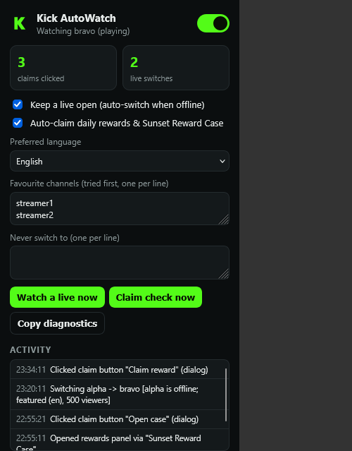
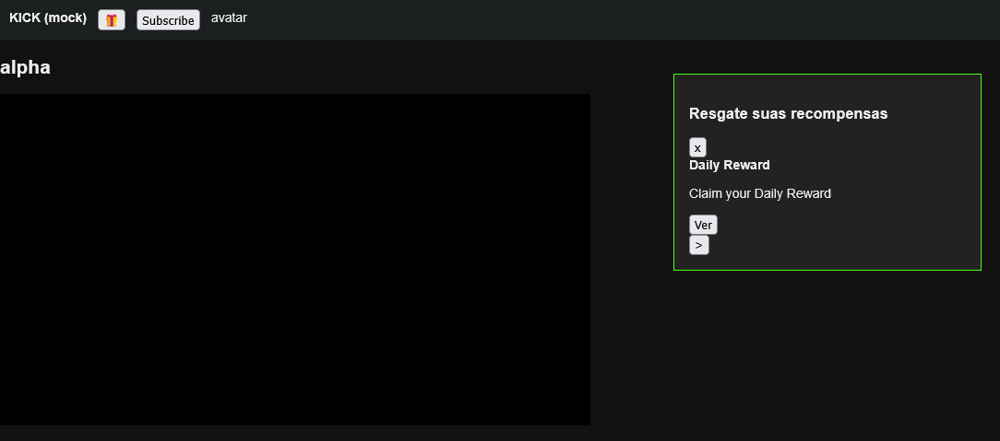
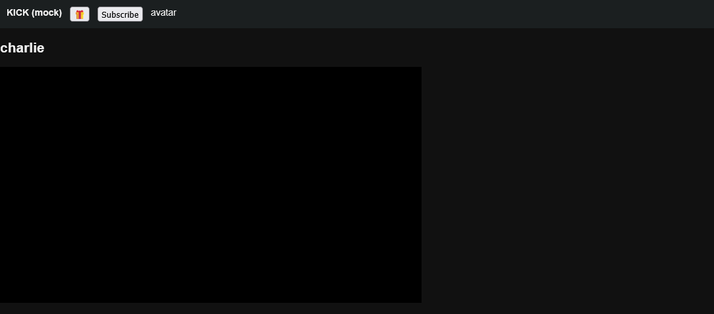

# Kick AutoWatch

Extensão para **Firefox** que mantém uma live aberta na [Kick](https://kick.com) e coleta recompensas automaticamente.

- **Manter live aberta** – se a live que você está assistindo ficar offline, a extensão troca sozinha para outra live (primeiro seus canais favoritos, depois as lives em destaque no seu idioma).
- **Coletar recompensas** – abre o painel de recompensas e clica em *Claim/Open* nas **Daily Rewards** e no **Sunset Reward Case** (o case diário da promoção GTA VI da Kick).
- **Toggle liga/desliga** no popup; com ele desligado a extensão não faz nada.
- Mantém o vídeo tocando (retoma se pausar, recarrega se travar) – necessário para contar o tempo de exibição.

| Popup | Auto-claim (mock) | Auto-switch (mock) |
|---|---|---|
|  |  |  |

> Os prints de claim/switch vêm de um **servidor Kick falso** usado nos testes automatizados (`tests/`). Não uso uma conta real da Kick nos testes — veja [Limitações](#limitações).

## Instalação

### Opção A – carregar temporariamente (qualquer Firefox, sem assinatura)
1. Abra `about:debugging#/runtime/this-firefox`
2. **Carregar extensão temporária…** → escolha `src/manifest.json` (ou o `.xpi` de `dist/`).
3. Dura até fechar o Firefox.

### Opção B – permanente
O Firefox estável só instala extensões **assinadas** pela Mozilla. Duas formas:
- **Assinar (grátis, não publica):** crie chaves em <https://addons.mozilla.org/developers/addon/api/key/> e rode  
  `npx web-ext sign --source-dir src --channel unlisted --api-key <JWT issuer> --api-secret <JWT secret>`  
  O `.xpi` assinado instala com *arrastar para o Firefox* e é permanente.
- **Firefox Developer Edition / Nightly / ESR:** em `about:config` defina `xpinstall.signatures.required = false` e instale `dist/kick-autowatch-1.1.0.xpi` em `about:addons` → engrenagem → *Instalar a partir de arquivo*.

## Uso
1. Abra uma live na Kick (e faça login – as recompensas exigem conta).
2. Clique no ícone da extensão e ative o toggle (aparece `ON` no ícone).
3. Opcional: escolha idioma, liste **canais favoritos** (tentados primeiro) e canais **bloqueados**.

Botões do popup: *Watch a live now* (escolhe uma live agora), *Claim check now* (procura recompensas agora), *Copy diagnostics* (copia os botões que a extensão enxerga – útil se a Kick mudar o layout).

## Como funciona
Veja [docs/HOW_IT_WORKS.md](docs/HOW_IT_WORKS.md). Resumo:
- Status da live: `GET /api/v2/channels/{slug}` (campo `livestream`). Duas checagens offline seguidas (~40 s) disparam a troca.
- Nova live: favoritos → `GET /stream/featured-livestreams/{idioma}` (sorteia entre as 10 com mais viewers).
- Recompensas: heurística de DOM (ver `src/selectors.js`) – acha o ícone de recompensas/case, abre o painel e clica no botão *Claim/Open*; nunca clica em botões com *subscribe/gift/buy/follow…*.
- Só atua em páginas de canal (`kick.com/<canal>`); home, `/drops`, `/browse` etc. não são tocadas.

## Desenvolvimento e testes
```bash
python scripts/build.py          # gera dist/kick-autowatch-<versão>.xpi
pip install selenium
python tests/e2e.py --shots      # Firefox real + Kick falso (13 checagens) e regenera os prints
```
Estrutura: `src/` (extensão), `tests/` (mock + e2e), `scripts/` (build), `docs/`.

## Limitações
- **Verificado na Kick real (conta logada, interface em português):** a extensão abriu o painel *Resgate suas recompensas* (botão `aria-label="Resgate sua recompensa"`), clicou em *Resgatar* e a **Daily Reward foi resgatada**. O painel é um carrossel (Sunset Reward Case → Daily Reward); a extensão percorre as páginas e fecha o painel quando nada está liberado. Botões bloqueados (`aria-disabled="true"`, "Assista por mais N minutos") são ignorados.
- **Ainda não visto ao vivo:** o clique final no *Sunset Reward Case* (estava a ~44 min de liberar durante o teste) e o texto exato do botão depois de liberado. Se a Kick mudar o markup ou o texto, ajuste `src/selectors.js` (use *Copy diagnostics* para ver o que a extensão enxerga).
- O Sunset Reward Case exige 3 h assistindo por dia; a aba precisa ficar aberta com o vídeo tocando.
- Automatizar cliques pode contrariar os termos da Kick; use por sua conta e risco. Projeto não afiliado à Kick.

## Licença
MIT © Filipe Rocha
